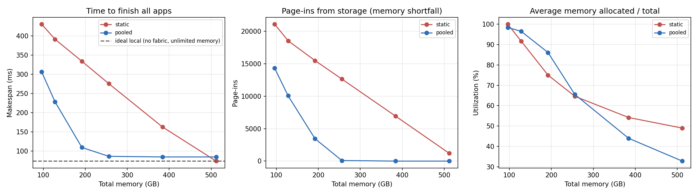
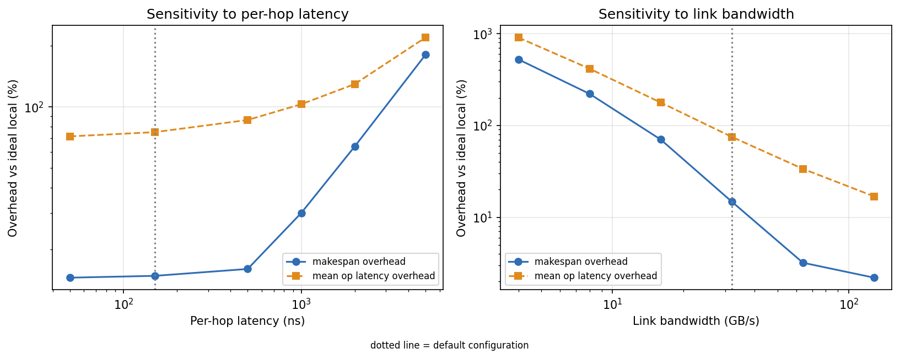
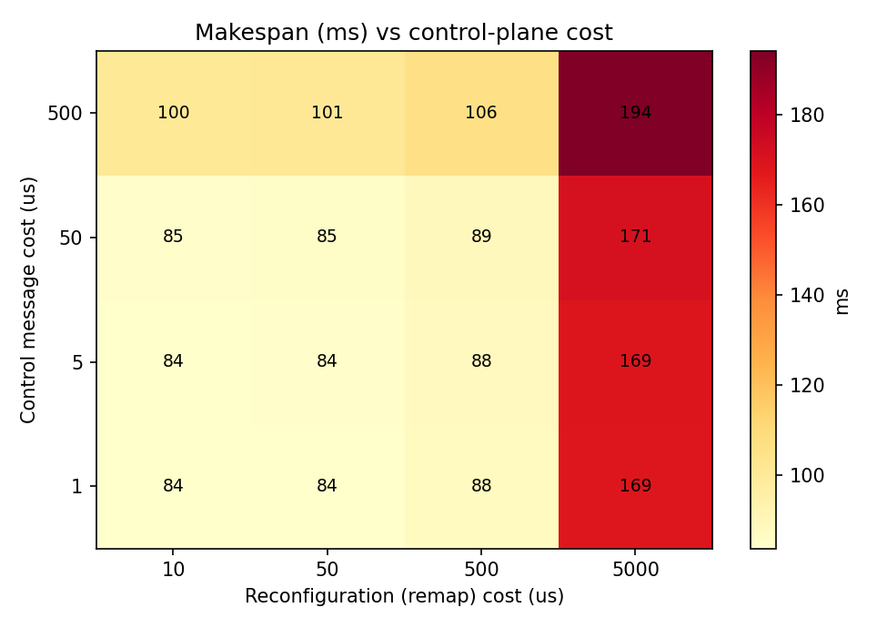

# Dynamic Composition of Disaggregated Resources: Simulation Report

## 1. Question
Can compute, memory, storage and accelerator resources that are physically separated be organised at run time into
one managed system, and what does that cost compared with fixed servers?

## 2. Architecture
- **Pools**: compute nodes, memory nodes, storage nodes and accelerator nodes, spread over racks.
- **Interconnect**: every node has a port, and every rack has a shared (oversubscribed) uplink. Latency = hops x 150 ns
  + serialization at the slowest link + queueing when links are busy. Same-rack nodes are 2 hops apart, cross-rack 4.
- **Remote access** = request over the fabric + protocol cost (300 ns for memory) + node service time + data return.
- **Discovery**: nodes register and send heartbeats every 1 ms. A node that misses 3 is treated as failed and is no longer offered.
- **Orchestrator**: a single-threaded control plane (operations are serialized) offering allocate, grow, shrink,
  migrate and rebalance. Allocations can span nodes and are all-or-nothing. Placement policies: first-fit, nearest-fit.
  Every operation pays control-message and remap costs.
- **Workloads**: three phase-based apps (in-memory analytics, ML training, ETL). Demand changes per phase. If an app holds less
  memory than its working set, the shortfall becomes page-ins from storage. Without an accelerator, work falls back to the CPU.

## 3. Method
Each experiment runs the same three apps (seed 42) on: **pooled** (4 memory nodes, 3 compute, 2 storage, 2 accelerator),
**static** (3 fixed servers with the same total hardware; each app pinned to one server and holding its peak demand), and
an **ideal-local** reference (no fabric, 512 GB per server). Metrics: makespan (time for all apps to finish), mean and p99
operation latency, page-ins, allocated memory, and control-plane waiting time.

## 4. Results

### 4.1 Pooling vs fixed servers (Figure 1, experiment 1)

| Total memory | Static makespan | Pooled makespan |
|---|---|---|
| 512 GB | 73.4 ms | 84.3 ms |
| 384 GB | 162.5 ms | 84.2 ms |
| 256 GB | 275.5 ms | 85.9 ms |
| 192 GB | 333.7 ms | 109.0 ms |
| 128 GB | 391.2 ms | 228.0 ms |
| 96 GB | 430.4 ms | 306.4 ms |

- With plentiful memory, static servers are faster (73.4 vs 84.3 ms): pooling costs about 15% because of remote access.
- When memory is tighter, pooled is much faster (about 1.9x at 384 GB and 3.2x at 256 GB). The static analytics server cannot
  borrow idle memory from the other servers, so it pages to storage; pooled lends it out.
- Pooled at 256 GB (half the memory) is 17% slower than static at 512 GB, and nearly equal to pooled at 512 GB.
- At 192 GB and below the combined peaks no longer fit and pooled degrades too, but still beats static.

### 4.2 Cost of remote access (Figure 2, experiment 2)

- Default fabric (150 ns per hop, 32 GB/s): +14.8% makespan, +75% mean operation latency vs ideal local.
- 93% of a remote memory read is fabric time; for storage 32%, for accelerator calls 21%.
- Per-hop latency: 50 to 500 ns stays at 14.5-16% makespan overhead; 1 us gives 30%, 2 us 64%, 5 us 180%.
- Link bandwidth is the stronger lever: 8 GB/s gives +221%, 16 GB/s +70%, 64 GB/s +3.2%, 128 GB/s +2.2%.

### 4.3 Control-plane overhead (Figure 3, experiment 3)

- With default costs the orchestrator ran 27 operations and apps waited about 1.4 ms in total (1.6% of the 84 ms run);
  one full rebalance in the context example took 135 us.
- Control message cost up to 50 us barely matters; at 500 us makespan rises from 84 to 100 ms.
- The remap cost dominates: 500 us per remap adds about 4%; 5 ms doubles the makespan.
- First-fit and nearest-fit gave almost identical results (84.2 vs 84.3 ms) in this scenario.

## 5. Conclusions
1. **Dynamic composition is feasible.** Discovery, allocation, runtime grow/shrink/migrate and cross-application rebalancing all
   work in the simulator, with the context example (memory moved from one app to another) completed in 135 us of control-plane time.
2. **The overhead is dominated by the data path, not the control plane.** Remote access costs about 15% of total run time and 75%
   of per-operation latency, while control-plane waiting is under 2% at default settings.
3. **Pooling pays off when memory is the scarce resource.** It lets the same workload run in about half the memory with little
   slowdown, but it is slower than fixed servers when memory is plentiful.
4. **Design targets suggested by the results**: links of 64 GB/s or more, per-hop latency under about 500 ns, and remap cost under
   about 500 us. Outside these ranges the overhead grows quickly.

## 6. Limitations
- Single random seed and a deterministic scenario, so no confidence intervals. Only three synthetic applications.
- The static baseline splits memory equally across three servers; a differently sized static layout would narrow the gap.
- Memory shortfall is modelled as page-ins from storage; there is no caching, prefetching or CPU-side cache in the remote path.
- Failures are detected, but allocations on a failed node are not recovered. There is a single orchestrator with no replication.
- The "memory allocated" panels in Figure 1 show reservation, not useful use: static reserves each app's peak for the whole run.
- Results depend on the assumed latencies and bandwidths in `sim/config.py`; they are not measurements of real hardware.
